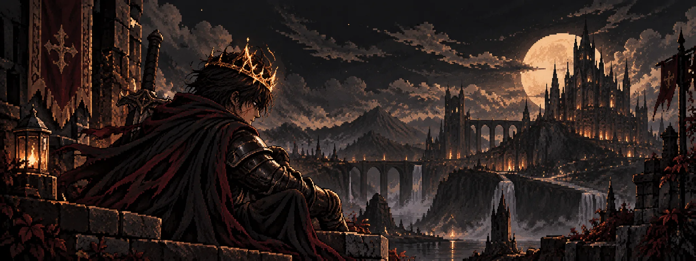

# ⚔️ THE ASHEN KNIGHT

*Forged through patience. Built one quest at a time.*

**Computer Engineering Student · Chile**

✦ ─────── ⚔️ ─────── ✦

## 🛡️ The Adventurer

An aspiring developer exploring the world of software development, one challenge at a time.

Currently studying Computer Engineering and turning curiosity into practical projects.

## 📜 The Quest Log

*Every project begins as a small quest.*

| Quest | Description | Status |
|---|---|---|
| ⚔️ PULSO | Building a fantasy-inspired Pomodoro RPG | 🟡 In progress |
| 🛡️ Git & GitHub | Learning version control | ✅ First milestone completed |
| 📖 Web Development | Exploring frontend fundamentals | 🟡 In progress |

## 🗡️ The Arsenal

*Tools and technologies I'm currently learning.*

### Current Equipment

### Exploring

---

**Every skill is earned, one quest at a time.**

✦ ─────── 🔥 ─────── ✦

